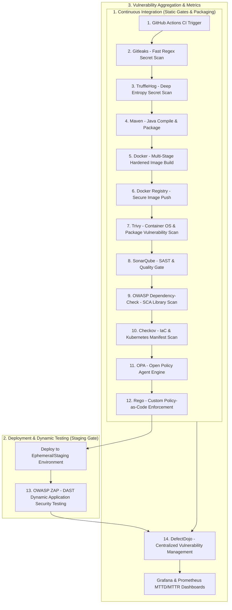

# 🛡️ Secure DevOps Pipeline (DevSecOps) — Complete Interview Preparation Guide

This document is a comprehensive, deep-dive interview preparation guide detailing every stage in the **Cyber Shield Secure DevOps Pipeline**, including static checks (SAST, SCA, Secrets, IaC, PaC) and dynamic checks (DAST with OWASP ZAP).

For each stage, it covers:
- **Exact File Locations & Line Numbers**
- **What Scanning / Action it Does**
- **How It Works (Technical Execution & Commands)**
- **Why It Is Used (Security Justification & Threat Mitigation)**
- **Why DAST (OWASP ZAP) is structured separately from the static CI pipeline**
- **Interview Q&A & Key Talking Points**

---

## 🗺️ End-to-End Pipeline Flowchart (CI + CD / DAST)



---

## 📑 Detailed Breakdown of Each Pipeline Stage

---

### 1. GitHub Actions
* **Security Discipline:** CI/CD Orchestration & Pipeline Automation
* **Exact File Location:** [pipeline.yml](file:///d:/Projects/Cyber%20Shield/secure-devops-pipeline/.github/workflows/pipeline.yml#L1-L166)

#### What It Does:
GitHub Actions serves as the central orchestration engine. It automates the end-to-end execution of all builds, tests, security scanners, containerization, and reporting workflows whenever developers push code or create pull requests.

#### How It Works:
- Configured via YAML in `.github/workflows/pipeline.yml`.
- Triggers on `push` events to any branch (`branches: ['**']`) at [pipeline.yml:L3-L6](file:///d:/Projects/Cyber%20Shield/secure-devops-pipeline/.github/workflows/pipeline.yml#L3-L6).
- Executes on a `self-hosted` runner at [pipeline.yml:L14](file:///d:/Projects/Cyber%20Shield/secure-devops-pipeline/.github/workflows/pipeline.yml#L14) to enable direct network connectivity to local security services (such as SonarQube on port `9000` and DefectDojo on port `8000`).
- Manages credentials and sensitive tokens securely using GitHub Encrypted Secrets (`${{ secrets.DOCKER_USERNAME }}`, `${{ secrets.SONAR_TOKEN }}`, `${{ secrets.NVD_API_KEY }}`).

#### Why It Is Used:
- **Shift-Left Security:** Enforces security scanning automatically at the moment code is committed, preventing vulnerable code from reaching production.
- **Fail-Fast Feedback:** Provides instant feedback directly in the developer's pull request or commit status, drastically reducing Mean Time to Remediate (MTTR).
- **Auditability & Repeatability:** Guarantees that every deployment artifact passes identical, deterministic security controls.

#### 💡 Interview Focus:
> **Q: Why use a self-hosted runner instead of `ubuntu-latest`?**  
> **A:** Self-hosted runners execute within the internal network / host machine, allowing the pipeline to communicate directly with on-premises/local services like SonarQube (`http://127.0.0.1:9000`) and DefectDojo (`http://127.0.0.1:8000`) without exposing internal tools to the public internet.

---

### 2. Gitleaks
* **Security Discipline:** Secret Detection / Static Credential Analysis
* **Exact File Location:** [pipeline.yml:L23-L30](file:///d:/Projects/Cyber%20Shield/secure-devops-pipeline/.github/workflows/pipeline.yml#L23-L30)

#### What It Does:
Gitleaks scans the source code repository, commit history, and working tree for hardcoded secrets, private keys, API tokens, AWS keys, database credentials, and certificates before any compilation occurs.

#### How It Works:
- Runs via Docker container `zricethezav/gitleaks:latest`.
- Command executed:
  ```bash
  docker run --rm -v $PWD:/repo zricethezav/gitleaks:latest detect \
    --source=/repo \
    --no-git \
    --exit-code 1
  ```
- Scans files using predefined regular expressions and rule sets targeting over 100+ common secret patterns (e.g., Slack tokens, Stripe keys, RSA private keys, GitHub PATs).

#### Why It Is Used:
- **Prevents Secret Sprawl:** Hardcoded credentials pushed to git repositories are immediately accessible to attackers and difficult to purge from commit history.
- **Speed:** Gitleaks is written in Go and performs fast pattern matching, making it an ideal first-line gate.

#### 💡 Interview Focus:
> **Q: Why run secret scanning before Maven build?**  
> **A:** If secrets exist in the source code or properties files, the pipeline should fail immediately before wasting compute cycles and memory building artifacts or creating Docker containers.

---

### 3. TruffleHog
* **Security Discipline:** Deep Entropy & Secret Verification Scan
* **Exact File Location:** [pipeline.yml:L31-L36](file:///d:/Projects/Cyber%20Shield/secure-devops-pipeline/.github/workflows/pipeline.yml#L31-L36)

#### What It Does:
TruffleHog performs deep secret scanning using both regex detectors and Shannon entropy analysis. It also supports live verification of discovered credentials (checking if keys are actively valid against target APIs).

#### How It Works:
- Runs via Docker container `ghcr.io/trufflesecurity/trufflehog:latest`.
- Command executed:
  ```bash
  docker run --rm -v $PWD:/repo ghcr.io/trufflesecurity/trufflehog:latest \
    filesystem /repo --fail --no-update
  ```
- Scans the mounted filesystem for high-entropy strings and structured secret signatures.

#### Why It Is Used:
- **Defense in Depth:** While Gitleaks excels at fast signature/regex scanning, TruffleHog catches unstructured, high-entropy secrets (e.g., custom Base64 hashes, randomly generated passwords, obscure API keys) that do not match standard regex patterns.
- **Reduces False Positives:** Dual scanning ensures maximum coverage with minimal blind spots.

#### 💡 Interview Focus:
> **Q: Why use both Gitleaks and TruffleHog in the same pipeline?**  
> **A:** This provides layered secret detection. Gitleaks is rule/pattern-based (fast with well-defined token formats), whereas TruffleHog incorporates Shannon entropy checks and verified detector engines to capture custom or unstructured secrets that evade standard regex.

---

### 4. Maven (Java Build Tool)
* **Security Discipline:** Build Automation & Java Dependency Resolution
* **Exact File Location:** 
  - Workflow step: [pipeline.yml:L37-L48](file:///d:/Projects/Cyber%20Shield/secure-devops-pipeline/.github/workflows/pipeline.yml#L37-L48)
  - Project configuration: [pom.xml](file:///d:/Projects/Cyber%20Shield/secure-devops-pipeline/app/pom.xml)

#### What It Does:
Compiles the Java source code (Spring Boot PetClinic application), resolves project dependencies, compiles classes, and packages the application into an executable `.jar` file.

#### How It Works:
- Sets up Eclipse Temurin JDK 17 via `actions/setup-java@v4.2.1`.
- Executes Maven build command:
  ```bash
  cd app
  mvn clean install -DskipTests -Dcheckstyle.skip=true -Dspring-javaformat.skip=true
  ```
- Builds the artifact inside `app/target/` ready for container packaging and downstream SAST analysis.

#### Why It Is Used:
- **Deterministic Builds:** Manages dependencies via `pom.xml`, enforcing specific dependency versions (e.g., upgraded Thymeleaf `3.1.4.RELEASE` and Jackson `2.18.0` in [pom.xml:L43-L58](file:///d:/Projects/Cyber%20Shield/secure-devops-pipeline/app/pom.xml#L43-L58) to eliminate known CVEs).
- Prepares the binary for SonarQube bytecode analysis and Docker container packaging.

#### 💡 Interview Focus:
> **Q: How does Maven configuration contribute to application security?**  
> **A:** Through the `<dependencyManagement>` section in `pom.xml`, security engineers override transitive dependencies to enforce patched library versions across the entire project, mitigating supply chain vulnerabilities.

---

### 5. Docker
* **Security Discipline:** Multi-Stage Build & Container Hardening
* **Exact File Location:** 
  - Workflow step: [pipeline.yml:L56-L59](file:///d:/Projects/Cyber%20Shield/secure-devops-pipeline/.github/workflows/pipeline.yml#L56-L59)
  - Hardened Dockerfile: [Dockerfile](file:///d:/Projects/Cyber%20Shield/secure-devops-pipeline/docker/Dockerfile#L1-L32)

#### What It Does:
Packages the compiled Spring Boot application into an immutable, containerized Linux image following container hardening best practices.

#### How It Works:
- Builds image using `docker build -t anoop1605/devops-app -f docker/Dockerfile .`.
- **Multi-Stage Build Pattern:**
  1. *Build Stage (`builder`)* in [Dockerfile:L2-L10](file:///d:/Projects/Cyber%20Shield/secure-devops-pipeline/docker/Dockerfile#L2-L10): Uses `eclipse-temurin:17-jdk-jammy` to extract JAR layers into libraries, classes, and metadata.
  2. *Runtime Stage* in [Dockerfile:L13-L32](file:///d:/Projects/Cyber%20Shield/secure-devops-pipeline/docker/Dockerfile#L13-L32): Uses a minimal JRE base image (`eclipse-temurin:17-jre-jammy`) without the full JDK compiler or build utilities.
- **Security Hardening Implemented:**
  - Creates a dedicated non-root user `appuser` (UID `10001`) with `/sbin/nologin` ([Dockerfile:L23](file:///d:/Projects/Cyber%20Shield/secure-devops-pipeline/docker/Dockerfile#L23)).
  - Explicitly switches to non-root: `USER appuser` ([Dockerfile:L25](file:///d:/Projects/Cyber%20Shield/secure-devops-pipeline/docker/Dockerfile#L25)).
  - Defines an automated container `HEALTHCHECK` ([Dockerfile:L28-L29](file:///d:/Projects/Cyber%20Shield/secure-devops-pipeline/docker/Dockerfile#L28-L29)).
  - Uses layered JAR execution for faster startup and minimal attack surface ([Dockerfile:L32](file:///d:/Projects/Cyber%20Shield/secure-devops-pipeline/docker/Dockerfile#L32)).

#### Why It Is Used:
- **Minimizes Attack Surface:** Multi-stage builds prevent build tools, compilers, shell utilities, and unnecessary packages from existing in the production image.
- **Mitigates Container Breakouts:** Running as a non-root user prevents root escalation attacks if the application is compromised.

#### 💡 Interview Focus:
> **Q: Why is `USER appuser` with `UID 10001` critical in container security?**  
> **A:** If a vulnerability allows Remote Code Execution (RCE) inside the container, the attacker only gains privileges of the unprivileged `appuser`. If the container ran as root (UID 0), an attacker breaking out of the container namespace could obtain root privileges on the underlying host.

---

### 6. Docker Registry (Docker Hub)
* **Security Discipline:** Artifact Storage & Distribution Control
* **Exact File Location:** [pipeline.yml:L49-L76](file:///d:/Projects/Cyber%20Shield/secure-devops-pipeline/.github/workflows/pipeline.yml#L49-L76)

#### What It Does:
Authenticates against Docker Hub using encrypted secrets and securely uploads the verified container image artifact to the central repository.

#### How It Works:
- Uses `docker/login-action@v3.3.0` with secrets `${{ secrets.DOCKER_USERNAME }}` and `${{ secrets.DOCKER_PASSWORD }}` ([pipeline.yml:L50-L54](file:///d:/Projects/Cyber%20Shield/secure-devops-pipeline/.github/workflows/pipeline.yml#L50-L54)).
- Includes enterprise-grade exponential backoff retry logic (up to 5 retries with timeout) in [pipeline.yml:L61-L75](file:///d:/Projects/Cyber%20Shield/secure-devops-pipeline/.github/workflows/pipeline.yml#L61-L75) to handle network jitter gracefully:
  ```bash
  timeout 120 docker push anoop1605/devops-app
  ```

#### Why It Is Used:
- Serves as the single source of truth for deployable image versions.
- Ensures only authenticated, authorized CI/CD pipelines can publish images to the registry.

#### 💡 Interview Focus:
> **Q: What security measures protect Docker Registry interactions?**  
> **A:** Ephemeral authentication via CI secrets (never hardcoded), image digest verification (SHA-256 pinning), and limiting push permissions to dedicated service accounts.

---

### 7. Trivy
* **Security Discipline:** Container Image Vulnerability & OS Package Scanning
* **Exact File Location:** [pipeline.yml:L77-L92](file:///d:/Projects/Cyber%20Shield/secure-devops-pipeline/.github/workflows/pipeline.yml#L77-L92)

#### What It Does:
Trivy (by Aqua Security) scans the container image for known Common Vulnerabilities and Exposures (CVEs) within both OS-level packages (Debian/Ubuntu packages) and language-specific application dependencies (Java JARs).

#### How It Works:
- Executes via `docker run` using `aquasec/trivy:latest`:
  ```bash
  docker run --rm -v /var/run/docker.sock:/var/run/docker.sock aquasec/trivy:latest image \
    --format json \
    --output /root/.cache/trivy-report.json \
    --severity CRITICAL,HIGH \
    --ignore-unfixed \
    --vuln-type os,library \
    --scanners vuln \
    anoop1605/devops-app
  ```
- Mounts `/var/run/docker.sock` to scan local Docker daemon images directly.
- Filters for actionable items (`--ignore-unfixed` ignores vulnerabilities with no available vendor patch).
- Outputs findings in JSON format (`trivy-report.json`) for downstream ingestion into DefectDojo.

#### Why It Is Used:
- **Container Supply Chain Security:** While source code might be safe, the underlying base image OS packages (e.g., OpenSSL, glibc, systemd) may carry critical CVEs.
- **Actionable Remediation:** `--ignore-unfixed` prevents pipeline noise by focusing developer effort strictly on remediable flaws.

#### 💡 Interview Focus:
> **Q: What is the difference between OS package scanning and library scanning in Trivy?**  
> **A:** OS scanning inspects system-level packages installed by the Linux distribution package manager (`apt`, `apk`, `yum`), while library scanning inspects application language dependencies (`pom.xml`, `package.json`, `requirements.txt`) packaged inside the image layers.

---

### 8. SonarQube
* **Security Discipline:** SAST (Static Application Security Testing) & Code Quality Gate
* **Exact File Location:** [pipeline.yml:L93-L144](file:///d:/Projects/Cyber%20Shield/secure-devops-pipeline/.github/workflows/pipeline.yml#L93-L144)

#### What It Does:
Analyzes source code and compiled bytecode to find security vulnerabilities (OWASP Top 10, CWEs, SQL Injection, XSS), security hotspots, bugs, code smells, and enforces a Quality Gate.

#### How It Works:
1. **Health Verification:** Pipeline checks SonarQube readiness via REST API polling (`curl -s http://127.0.0.1:9000/api/system/status`) in [pipeline.yml:L94-L115](file:///d:/Projects/Cyber%20Shield/secure-devops-pipeline/.github/workflows/pipeline.yml#L94-L115).
2. **Scanner Execution:** Runs the Maven Sonar plugin:
   ```bash
   cd app
   mvn org.sonarsource.scanner.maven:sonar-maven-plugin:4.0.0.4121:sonar \
     -Dsonar.projectKey=secure-devops \
     -Dsonar.host.url=http://127.0.0.1:9000 \
     -Dsonar.login=${{ secrets.SONAR_TOKEN }}
   ```
3. **Quality Gate Enforcement:** Queries SonarQube Quality Gate API and parses status with `jq` in [pipeline.yml:L130-L144](file:///d:/Projects/Cyber%20Shield/secure-devops-pipeline/.github/workflows/pipeline.yml#L130-L144):
   ```bash
   STATUS=$(curl -s -u ${{ secrets.SONAR_TOKEN }}: \
     "http://127.0.0.1:9000/api/qualitygates/project_status?projectKey=secure-devops" \
     | jq -r '.projectStatus.status')
   ```

#### Why It Is Used:
- **Early Vulnerability Identification:** Catches flaws in application logic (e.g., insecure deserialization, improper input sanitization) during compilation.
- **Enforces Security Baseline:** Quality Gates block pull requests if new vulnerabilities or insufficient test coverage thresholds are breached.

#### 💡 Interview Focus:
> **Q: What is a Quality Gate in SonarQube?**  
> **A:** A Quality Gate is a set of Boolean conditions code must meet before releasing (e.g., 0 new vulnerabilities, 0 security hotspots unreviewed, maintainability rating A). It acts as an automated binary pass/fail gate for the pipeline.

---

### 9. OWASP Dependency-Check
* **Security Discipline:** SCA (Software Composition Analysis)
* **Exact File Location:** [pipeline.yml:L145-L154](file:///d:/Projects/Cyber%20Shield/secure-devops-pipeline/.github/workflows/pipeline.yml#L145-L154)

#### What It Does:
Inspects all Java third-party dependencies and transitive libraries declared in `pom.xml`, matching them against the National Vulnerability Database (NVD) for known CVEs and CVSS scores.

#### How It Works:
- Runs through the Maven plugin:
  ```bash
  cd app
  mvn org.owasp:dependency-check-maven:check \
    -DnvdApiKey=${{ secrets.NVD_API_KEY }} \
    -Dformat=XML \
    -DfailBuildOnCVSS=11 \
    -DskipProvidedScope=true \
    -DdataDirectory="$HOME/odc-data"
  ```
- Authenticates with an official NVD API Key to avoid rate-limiting.
- Uses persistent local storage (`-DdataDirectory="$HOME/odc-data"`) to cache NVD CVE feeds across pipeline runs for performance.
- Exports findings to `app/target/dependency-check-report.xml` for DefectDojo consumption.

#### Why It Is Used:
- **Supply Chain Threat Mitigation:** Over 80% of modern application code comprises open-source dependencies. Known vulnerabilities in transitive libraries (e.g., Log4j, Spring4Shell) represent major attack vectors.
- Provides precise CVSS scoring and CVE identifiers for every vulnerable library.

#### 💡 Interview Focus:
> **Q: How does OWASP Dependency-Check differ from SonarQube?**  
> **A:** SonarQube performs SAST (inspecting first-party code written by your developers for logic bugs and flaws). OWASP Dependency-Check performs SCA (inspecting third-party open-source libraries against public CVE databases for known vulnerabilities).

---

### 10. Checkov
* **Security Discipline:** Infrastructure-as-Code (IaC) Static Analysis
* **Exact File Location:** 
  - Workflow step: [pipeline.yml:L155-L166](file:///d:/Projects/Cyber%20Shield/secure-devops-pipeline/.github/workflows/pipeline.yml#L155-L166)
  - Target Manifests: [k8s/deployment.yaml](file:///d:/Projects/Cyber%20Shield/secure-devops-pipeline/k8s/deployment.yaml) and [docker/Dockerfile](file:///d:/Projects/Cyber%20Shield/secure-devops-pipeline/docker/Dockerfile)

#### What It Does:
Checkov (by Bridgecrew/Palo Alto Networks) statically parses Infrastructure-as-Code files (Kubernetes manifests, Dockerfiles, Terraform, GitHub Actions workflows) to detect security misconfigurations and compliance violations.

#### How It Works:
- Runs via Docker container `bridgecrewio/checkov:latest`:
  ```bash
  docker run --rm -v ${{ github.workspace }}:/app bridgecrewio/checkov:latest \
    --framework kubernetes,dockerfile,github_actions \
    --directory /app \
    --output cli \
    --output json \
    --skip-framework helm \
    --output-file-path /app/checkov-report.json
  ```
- Evaluates Kubernetes YAML against CIS Kubernetes Benchmarks, checking for:
  - Disallowing root containers (`runAsNonRoot: true`)
  - Dropping Linux capabilities (`drop: [ALL]`)
  - Preventing privilege escalation (`allowPrivilegeEscalation: false`)
  - Setting CPU & Memory limits
  - Disabling automatic service account token mounting (`automountServiceAccountToken: false`)
- Generates `checkov-report.json` for DefectDojo ingestion.

#### Why It Is Used:
- Prevents cloud and cluster misconfigurations *before* deployment into Kubernetes clusters.
- Ensures all deployed workloads comply with the principle of least privilege.

#### 💡 Interview Focus:
> **Q: What security controls does our Kubernetes manifest enforce against Checkov checks?**  
> **A:** In [deployment.yaml:L7-L24](file:///d:/Projects/Cyber%20Shield/secure-devops-pipeline/k8s/deployment.yaml#L7-L24), we explicitly set:
> 1. `automountServiceAccountToken: false` (prevents pod identity theft)
> 2. `runAsNonRoot: true` and `runAsUser: 10000` (prevents root execution)
> 3. `allowPrivilegeEscalation: false` (blocks SUID escalation)
> 4. `capabilities.drop: ["ALL"]` (removes all dangerous Linux capabilities)
> 5. `resources.limits.cpu` & `memory` (prevents container DoS / resource starvation)

---

### 11. OPA (Open Policy Agent)
* **Security Discipline:** Declarative Policy Engine & Policy-as-Code (PaC)
* **Exact File Location:** 
  - Policy directory: [policy/](file:///d:/Projects/Cyber%20Shield/secure-devops-pipeline/policy/)
  - Target enforcement: [k8s/deployment.yaml](file:///d:/Projects/Cyber%20Shield/secure-devops-pipeline/k8s/deployment.yaml)

#### What It Does:
Open Policy Agent (OPA) provides a unified, domain-agnostic policy engine for decoupling policy decision-making from application and infrastructure code. In the pipeline, it acts as a gatekeeper evaluating Kubernetes and Docker configurations against organizational governance rules.

#### How It Works:
- Takes structured data (JSON/YAML representations of Kubernetes manifests) as `input`.
- Evaluates the input against compiled policy rules written in the Rego query language.
- Produces boolean decisions or violation messages (`deny[msg]`).
- Can run locally in CI via `opa eval` or `conftest`, as well as in Kubernetes admission controllers (OPA Gatekeeper).

#### Why It Is Used:
- **Decoupled Governance:** Security teams write and update policies independently without modifying application source code or pipeline definitions.
- **Enterprise Consistency:** The exact same policy engine can enforce rules in CI/CD, Kubernetes Admission Control, Terraform deployments, and API Gateways.

#### 💡 Interview Focus:
> **Q: What is the difference between Checkov and OPA?**  
> **A:** Checkov provides out-of-the-box static analysis rules mapping to industry benchmarks (CIS, NIST, PCI-DSS). OPA is a general-purpose, custom policy engine allowing organizations to write bespoke, context-aware business logic and guardrails using Rego.

---

### 12. Rego (OPA Query Language)
* **Security Discipline:** Policy-as-Code Rule Definitions
* **Exact File Locations:**
  - [policy/no-root.rego](file:///d:/Projects/Cyber%20Shield/secure-devops-pipeline/policy/no-root.rego)
  - [policy/registry.rego](file:///d:/Projects/Cyber%20Shield/secure-devops-pipeline/policy/registry.rego)
  - [policy/resource.rego](file:///d:/Projects/Cyber%20Shield/secure-devops-pipeline/policy/resource.rego)

#### What It Does:
Rego is the declarative query language designed specifically for OPA to express complex, hierarchical data assertions with high performance.

#### How It Works & Rule Breakdown in the Project:
1. **Root Execution Policy ([no-root.rego](file:///d:/Projects/Cyber%20Shield/secure-devops-pipeline/policy/no-root.rego)):**
   ```rego
   package main

   deny[msg] {
     input.spec.containers[_].securityContext.runAsUser == 0
     msg = "Container must not run as root"
   }
   ```
   *Denies deployment if any container specifies `runAsUser == 0` (root).*

2. **Trusted Registry Policy ([registry.rego](file:///d:/Projects/Cyber%20Shield/secure-devops-pipeline/policy/registry.rego)):**
   ```rego
   package main

   approved = ["docker.io", "ghcr.io"]

   deny[msg] {
     image := input.spec.containers[_].image
     not allowed_registry(image)
     msg = sprintf("Unapproved registry: %s", [image])
   }

   allowed_registry(image) {
     some i
     startswith(image, approved[i])
   }
   ```
   *Prevents pulling images from untrusted or public third-party registries, permitting only approved registries (`docker.io`, `ghcr.io`).*

3. **Resource Guardrail Policy ([resource.rego](file:///d:/Projects/Cyber%20Shield/secure-devops-pipeline/policy/resource.rego)):**
   ```rego
   package main

   deny[msg] {
     container := input.spec.containers[_]
     not container.resources.limits.cpu
     msg = "CPU limit missing"
   }

   deny[msg] {
     container := input.spec.containers[_]
     not container.resources.limits.memory
     msg = "Memory limit missing"
   }
   ```
   *Blocks pods that do not declare CPU and memory limits, protecting clusters against noisy neighbor and DoS conditions.*

#### Why It Is Used:
- **Declarative & Expressive:** Easy to write assertions over deeply nested JSON/YAML structures.
- **Modular Maintainability:** New security requirements are introduced simply by adding a `.rego` file without altering build pipelines.

#### 💡 Interview Focus:
> **Q: How does Rego evaluate `deny[msg]`?**  
> **A:** In Rego, rules generate a set of violations. If the conditions inside the `deny` body evaluate to `true`, the error message is added to the `deny` set. If the set is empty, the manifest passes; if non-empty, the pipeline rejects the deployment.

---

### 13. OWASP ZAP (Zed Attack Proxy)
* **Security Discipline:** DAST (Dynamic Application Security Testing)
* **Exact File Locations:**
  - Context Configuration: [zap/sdop-context.xml](file:///d:/Projects/Cyber%20Shield/secure-devops-pipeline/zap/sdop-context.xml)
  - Active Scan Script: [zap/zap-active-scan.py](file:///d:/Projects/Cyber%20Shield/secure-devops-pipeline/zap/zap-active-scan.py)
  - DAST Guide & FR-11 Spec: [docs/ZAP-ENHANCEMENT-GUIDE.md](file:///d:/Projects/Cyber%20Shield/secure-devops-pipeline/docs/ZAP-ENHANCEMENT-GUIDE.md)

#### What It Does:
OWASP ZAP acts as a Dynamic Application Security Testing (DAST) web scanner / interception proxy. Unlike SAST (which inspects static code), ZAP tests the **live, running application** from the outside, attacking exposed HTTP/HTTPS endpoints to detect runtime vulnerabilities such as SQL Injection, Cross-Site Scripting (XSS), Broken Authentication, CSRF, insecure HTTP headers, and server misconfigurations.

#### How It Works:
1. **Target Context Scoping ([zap/sdop-context.xml](file:///d:/Projects/Cyber%20Shield/secure-devops-pipeline/zap/sdop-context.xml)):**
   - Configures target scope (`http://127.0.0.1:8080.*`).
   - Excludes noisy static assets (`.css`, `.js`, `.png`, `/actuator/*`).
   - Informs ZAP of backend tech stack (Java 17, Spring Boot 3.x).
2. **Scan Execution Modes:**
   - **Baseline Scan (Passive):** Spiders web pages and inspects HTTP responses without injecting intrusive attack payloads (~2-5 min).
     ```bash
     docker run --rm -v $(pwd):/zap/wrk/:rw zaproxy/zap-stable zap-baseline.py \
       -t http://127.0.0.1:8080 \
       -J zap-report.json \
       -n /zap/wrk/zap/sdop-context.xml
     ```
   - **Active Scan (Intrusive):** Uses [zap-active-scan.py](file:///d:/Projects/Cyber%20Shield/secure-devops-pipeline/zap/zap-active-scan.py) to fire active attack vectors (SQLi, command injection, path traversal) against exposed parameters.
3. **Automated Enforcement (PRD Requirement FR-11):**
   - Parses the resulting `zap-report.json`.
   - Any alert with `riskcode: 3` (CRITICAL) or `riskcode: 2` (HIGH) automatically fails the deployment gate (`exit 1`).

#### Why It Is Used:
- **Runtime Flaw Detection:** Catches vulnerabilities that cannot be identified statically (e.g., runtime environmental misconfigurations, HTTP response headers, CORS misconfigurations, session management flaws).
- **Zero Source-Code Assumption:** Tests the application exactly as an external threat actor or penetration tester would see it.

---

### ❓ Crucial Interview Question: Why is OWASP ZAP NOT in the Pre-Deployment CI Pipeline?

> **Interview Question:** *"Why is OWASP ZAP configured as a separate DAST staging stage rather than running in the main CI build workflow alongside Gitleaks, SonarQube, and Checkov?"*

#### 🎯 Complete Interview Answer:

There are **4 fundamental architectural reasons** why DAST (OWASP ZAP) is decoupled from the commit-level CI pipeline:

1. **Requirement of a Live, Running Runtime Environment (DAST vs. SAST):**
   - Tools like **SonarQube, Gitleaks, Checkov, and Dependency-Check** are *static* analysis tools—they analyze raw text, source code files, and manifests on disk without starting the application.
   - **OWASP ZAP requires a fully deployed, running application server** (`http://127.0.0.1:8080`) backed by a live database (e.g., H2/MySQL) and active networking. In a pure build/compile CI runner, no running application exists until after Docker containerization and deployment to an environment.

2. **Pipeline Velocity & Developer Feedback Loop (Fail-Fast):**
   - CI build checks (Gitleaks, TruffleHog, Maven, Checkov) execute in **under 2 to 3 minutes**, giving developers immediate feedback.
   - An **Active DAST scan** must spider hundreds of endpoints and fuzz thousands of HTTP requests with payloads. This takes **15 to 45+ minutes**. Running full DAST on every `git push` would paralyze developer productivity and bottleneck the CI queue.

3. **Data Mutation and State Pollution:**
   - Active DAST submits real HTTP `POST`, `PUT`, and `DELETE` requests with fuzzing payloads into forms and endpoints.
   - Running this directly in a build runner can corrupt test databases, lock test user accounts, or trigger rate-limiters. Therefore, DAST is safely executed in an isolated **ephemeral testing or staging environment**.

4. **Industry Standard Staging Gate Separation:**
   - In modern DevSecOps, security is split into two phases:
     - **CI Phase (Shift-Left):** Fast static checks (SAST, SCA, Secrets, IaC, PaC) before building & pushing the image.
     - **CD / Post-Deployment Phase (Shift-Right / Staging Gate):** Deploy the hardened container to an ephemeral staging environment $\rightarrow$ Execute OWASP ZAP DAST $\rightarrow$ Ingest findings into DefectDojo $\rightarrow$ Promote to Production only if FR-11 passes.

---

### 14. DefectDojo
* **Security Discipline:** Centralized Application Security Posture Management (ASPM) & Vulnerability Aggregation
* **Exact File Locations:**
  - Upload automation script: [defectdojo-upload.sh](file:///d:/Projects/Cyber%20Shield/secure-devops-pipeline/scripts/defectdojo-upload.sh)
  - Setup script: [setup-defectdojo.sh](file:///d:/Projects/Cyber%20Shield/secure-devops-pipeline/scripts/setup-defectdojo.sh)
  - Documentation: [DEFECTDOJO-SETUP.md](file:///d:/Projects/Cyber%20Shield/secure-devops-pipeline/docs/DEFECTDOJO-SETUP.md)
  - Metrics export to Grafana: [defectdojo-to-grafana.sh](file:///d:/Projects/Cyber%20Shield/secure-devops-pipeline/scripts/defectdojo-to-grafana.sh)

#### What It Does:
DefectDojo ingests, normalizes, deduplicates, and tracks vulnerability reports from all pipeline scanning tools (OWASP Dependency-Check, Checkov, Trivy, SonarQube, OWASP ZAP), providing a unified vulnerability management platform.

#### How It Works:
- Interacts with DefectDojo REST API v2 (`/api/v2/`):
  1. Authenticates using API Token (`Authorization: Token $API_KEY`).
  2. Queries or creates the Product (`Secure DevOps Pipeline`) at [defectdojo-upload.sh:L50-L94](file:///d:/Projects/Cyber%20Shield/secure-devops-pipeline/scripts/defectdojo-upload.sh#L50-L94).
  3. Creates an Engagement (`CI Pipeline Run`) timestamped for the build at [defectdojo-upload.sh:L96-L115](file:///d:/Projects/Cyber%20Shield/secure-devops-pipeline/scripts/defectdojo-upload.sh#L96-L115).
  4. Automatically uploads scan reports via `/api/v2/import-scan/` at [defectdojo-upload.sh:L151-L163](file:///d:/Projects/Cyber%20Shield/secure-devops-pipeline/scripts/defectdojo-upload.sh#L151-L163):
     - `app/target/dependency-check-report.xml` ➡️ `Dependency Check Scan`
     - `checkov-report.json` ➡️ `Checkov Scan`
     - `trivy-report.json` ➡️ `Trivy Scan`
     - `zap-report.json` ➡️ `ZAP Scan`
- Syncs findings to Prometheus and Grafana dashboards for executive reporting and MTTD/MTTR metrics tracking ([defectdojo-to-grafana.sh](file:///d:/Projects/Cyber%20Shield/secure-devops-pipeline/scripts/defectdojo-to-grafana.sh)).

#### Why It Is Used:
- **Eliminates Tool Silos:** Without DefectDojo, developers must check 5 different dashboards and report formats.
- **Automated Deduplication:** Merges identical findings across different scans, preventing alert fatigue.
- **Compliance & Metrics:** Tracks Mean Time To Detect (MTTD) and Mean Time To Remediate (MTTR) for audits and SLA enforcement.

#### 💡 Interview Focus:
> **Q: What is the business and operational value of DefectDojo in DevSecOps?**  
> **A:** It unifies disparate scanner outputs into a single pane of glass, correlates duplicate vulnerabilities across SAST, SCA, IaC, DAST, and container scans, tracks remediation lifecycles, and provides actionable metrics for engineering and security leadership.

---

## 📊 Summary Comparison Table for Quick Interview Recall

| # | Stage | Security Discipline | Scanning Target | Key Tool/Command | Output Artifact / Gate |
|---|---|---|---|---|---|
| **1** | **GitHub Actions** | CI/CD Orchestration | Workflow Pipeline | `actions/checkout`, `self-hosted` runner | Pipeline execution |
| **2** | **Gitleaks** | Secret Scanning | Git commits & working tree | `gitleaks detect --no-git` | Exit code 1 on secret |
| **3** | **TruffleHog** | Deep Secret Scanning | Filesystem & entropy | `trufflehog filesystem /repo` | High-entropy secret alerts |
| **4** | **Maven** | Build & Packaging | Java source code | `mvn clean install` | Compiled `.jar` artifact |
| **5** | **Docker** | Container Hardening | Multi-stage Dockerfile | `docker build -f docker/Dockerfile` | Hardened non-root image |
| **6** | **Docker Registry** | Image Distribution | Built Container Image | `docker push` (with retries) | Published image tag |
| **7** | **Trivy** | Container Vulnerability Scan | Docker image & OS layers | `trivy image --severity CRITICAL,HIGH` | `trivy-report.json` |
| **8** | **SonarQube** | SAST & Quality Gate | Java source & bytecode | `sonar-maven-plugin` | Quality Gate (`OK`/`ERROR`) |
| **9** | **OWASP Dep-Check** | SCA (Dependency Scan) | `pom.xml` third-party libs | `dependency-check-maven:check` | `dependency-check-report.xml` |
| **10** | **Checkov** | IaC Security Scanning | K8s YAML & Dockerfile | `checkov --framework kubernetes,dockerfile` | `checkov-report.json` |
| **11** | **OPA** | Policy-as-Code Engine | Structured YAML/JSON input | `opa eval` / Admission Controller | Policy decisions |
| **12** | **Rego** | Declarative Policy Rules | Manifest specifications | `no-root.rego`, `registry.rego`, `resource.rego` | `deny[msg]` violations |
| **13** | **OWASP ZAP** | DAST (Dynamic Web Scan) | Live running web app | `zaproxy zap-baseline.py` / `zap-active-scan.py` | `zap-report.json` (FR-11 Gate) |
| **14** | **DefectDojo** | ASPM / Vulnerability Mgmt | All scanner report files | `defectdojo-upload.sh` via API v2 | Unified dashboard & metrics |

---

## 🎯 Top DevSecOps Principles Demonstrated in this Pipeline

1. **Shift-Left Security:** Catching flaws during checkout/build stages before deployment.
2. **Defense in Depth:** Layered secret scanning (Gitleaks + TruffleHog), dual-phase code/runtime analysis (SonarQube SAST + OWASP ZAP DAST), and container hardening (Trivy + non-root Docker user).
3. **Least Privilege & Hardening:** Multi-stage Docker build, unprivileged user (`UID 10001`), dropping all Linux capabilities in Kubernetes.
4. **Policy as Code (PaC):** Enforcing immutable governance through OPA & Rego.
5. **Separation of CI vs CD Security:** Fast static verification in CI; thorough dynamic penetration testing (DAST) on live staging workloads.
6. **Centralized Visibility:** Aggregating all findings into DefectDojo and Grafana to track security KPIs (MTTD / MTTR).
