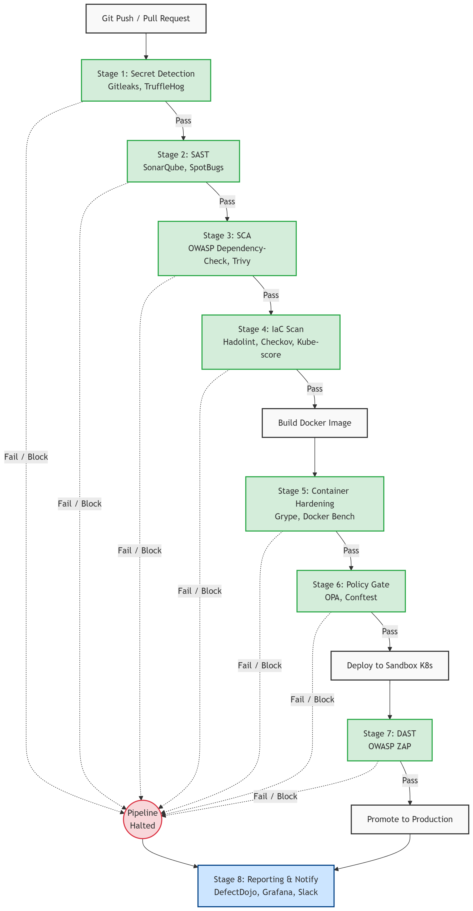

# Cyber Shield: Enterprise DevSecOps Pipeline

An automated, security-hardened Continuous Integration & Continuous Delivery (CI/CD) DevSecOps pipeline for modern Java Spring Boot applications. Built with automated vulnerability management, policy enforcement, and live security metrics telemetry.

---

## 🏗️ Architecture Overview

The pipeline shifts security left across the Software Development Life Cycle (SDLC) by automating SAST, SCA, Container Linting & Scanning, IaC Policy Checks, DAST, DefectDojo vulnerability centralization, and Grafana telemetry.



### Security Scan Gates

| Stage | Tool | Type | Target / Description |
| :--- | :--- | :--- | :--- |
| **SCA** | OWASP Dependency-Check | Software Composition Analysis | Third-party Maven dependency vulnerabilities (CVEs) |
| **SAST** | SonarQube / Semgrep | Static Application Security Testing | Source code quality, code smells, and security bugs |
| **Secret Detection** | Gitleaks / Trufflehog | Credential & Secret Scanning | Hardcoded API keys, tokens, and private keys |
| **IaC / Config** | Checkov & Conftest | Infrastructure-as-Code & Rego Policy | Dockerfile & Kubernetes manifest misconfigurations |
| **Container Scan** | Trivy | Image Vulnerability & SBOM | OS packages and application dependencies in container |
| **DAST** | OWASP ZAP | Dynamic Security Testing | Live web application vulnerability & API endpoint testing |
| **Vulnerability Mgmt**| DefectDojo | Aggregation & Deduping | Centralized dashboard for tracking & remediating findings |
| **Telemetry & Observability**| Prometheus & Grafana | Metrics Dashboard | Real-time security posture & pipeline health tracking |

---

## 📂 Project Structure

```text
Cyber Shield/
├── PRD.md                                    # Project Requirements Document
├── DEVSECOPS_PIPELINE_INTERVIEW_GUIDE.md     # Interview & Defense preparation guide
├── architecture.png / architecture.svg       # Architecture diagrams
└── secure-devops-pipeline/
    ├── README.md                             # Main pipeline documentation (this file)
    ├── .github/workflows/pipeline.yml        # Core GitHub Actions CI/CD workflow
    ├── app/                                  # Spring Boot PetClinic target application
    │   └── README.md                         # PetClinic local application run guide
    ├── scripts/                              # Pipeline orchestration & export scripts
    ├── policy/                               # Conftest Rego policies for Kubernetes & Docker
    └── docs/                                 # Operational & Setup documentation
        ├── TEAM-ONBOARDING-GUIDE.md          # Local developer & runner environment setup
        ├── SELF-HOSTED-RUNNER-SETUP.md       # Self-hosted GitHub runner installation
        ├── GITHUB-SECRETS-SETUP.md           # Required GitHub Actions secrets configuration
        ├── DEFECTDOJO-SETUP.md               # DefectDojo server setup & API config
        ├── GRAFANA-IMPORT-GUIDE.md           # Grafana dashboard & Prometheus datasource setup
        ├── PIPELINE-TESTING-GUIDE.md         # End-to-end pipeline verification steps
        ├── PROFESSOR-DEMO-SCRIPT.md          # Live demonstration script & talking points
        ├── FINAL-DEMO-GUIDE.md               # Quick execution runbook for project presentation
        ├── METRICS-CONNECTION-DIAGRAM.md     # Network flow diagram for metrics & telemetry
        └── archive/                          # Archived troubleshooting & migration logs
```

---

## 🚀 Quick Start

### 1. Prerequisites
- Docker & Docker Compose
- Java 17+ & Maven 3.8+
- GitHub repository with self-hosted or GitHub-hosted runner

### 2. Setting Up Components
Follow the detailed guides in the `docs/` folder:
1. **Team Onboarding & Environment**: [`docs/TEAM-ONBOARDING-GUIDE.md`](docs/TEAM-ONBOARDING-GUIDE.md)
2. **Self-Hosted Runner**: [`docs/SELF-HOSTED-RUNNER-SETUP.md`](docs/SELF-HOSTED-RUNNER-SETUP.md)
3. **GitHub Secrets Configuration**: [`docs/GITHUB-SECRETS-SETUP.md`](docs/GITHUB-SECRETS-SETUP.md)
4. **DefectDojo Vulnerability Management**: [`docs/DEFECTDOJO-SETUP.md`](docs/DEFECTDOJO-SETUP.md)
5. **Grafana Security Dashboards**: [`docs/GRAFANA-IMPORT-GUIDE.md`](docs/GRAFANA-IMPORT-GUIDE.md)

### 3. Demo & Presentation Guides
- **Live Demo Script**: [`docs/PROFESSOR-DEMO-SCRIPT.md`](docs/PROFESSOR-DEMO-SCRIPT.md)
- **Fast Runbook**: [`docs/FINAL-DEMO-GUIDE.md`](docs/FINAL-DEMO-GUIDE.md)
- **Interview & Technical Q&A**: [`DEVSECOPS_PIPELINE_INTERVIEW_GUIDE.md`](DEVSECOPS_PIPELINE_INTERVIEW_GUIDE.md)
